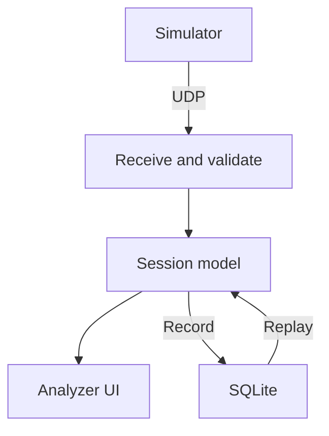

# Architecture

## Product boundary

PitWall is a telemetry analysis tool with its own small driving simulator. No racing
game is required. Two processes are planned: Simulator and Analyzer. Replay is a
mode of Analyzer. The current simulator implements headless vehicle physics, closed
track geometry and lap tracking with scripted demos. Analyzer still implements its
console entry point only. An integration test connects actual vehicle states to lap timing.

This diagram describes the target, not the currently implemented data flow.

## Dependency boundaries

`domain`, `simulation` and `track` are implemented reusable libraries. Introduce remaining
targets only when needed; the table includes the intended future responsibilities:

| Target | Responsibility | Dependencies |
| --- | --- | --- |
| domain | Units, telemetry values, session and lap types | Standard library |
| simulation | Vehicle dynamics and fixed-step scheduling | domain |
| track | Closed centreline, road corridor, projection and lap tracking | domain |
| telemetry | Codec, UDP receiver/sender, source state | domain, Boost.Asio, JSON |
| analysis | Session processing and distance-aligned comparison | domain |
| storage | SQLite schema, recording and loading | domain, SQLite |
| applications | Composition, rendering and user input | Relevant libraries |

The domain must never include GUI, sockets or database headers. No shared singleton
owns application state. The composition root in each application owns its services.
Use interfaces at actual substitution points (live/replay sources and storage), not
for every class. Do not create a monolithic TelemetryCore manager.

## Planned libraries

GLFW/OpenGL for windows and input, Dear ImGui for UI and simple top-down drawing,
ImPlot for charts, Boost.Asio for UDP, SQLite for recordings, nlohmann/json for
configuration and the initial wire codec, GoogleTest for unit tests. No SFML is
needed initially. Introduce and pin dependencies as implementation needs arise.

## Simulation

The current implementation uses a kinematic bicycle model and longitudinal acceleration/braking/drag.
This is not a tire-slip or drivetrain simulator. Fixed physics step: 10 ms; telemetry
interval: 20 ms. An accumulator separates physics updates from rendering. Bound
catch-up work after stalls, expose overruns, and never silently change the physics
step. The runner exposes dropped time per advance. Reset clears physics and clock;
the caller must assign a new session ID when starting a new telemetry session.
Pause handling and a full session lifecycle are future application responsibilities.

See [vehicle physics](physics.md) for implemented equations and numerical policies.

Track progress is a projection onto the track centreline. It is distinct from
distance travelled by the vehicle. Ordered checkpoints plus a directed finish-line
crossing determine valid laps; leaving the track invalidates the current lap.

The track library depends only on domain types, not physics. LapTracker owns an
immutable Track by value and receives position/time samples. It measures the rear
axle reference point; vehicle-body containment and track collisions are not modelled.
It validates the entire line segment between samples against the union of road
capsules, rejects discontinuities and interpolates crossing timestamps. Projection
progress is wrapped, not a monotonic lap-distance accumulator. See [tracks](tracks.md).

## Planned Analyzer concurrency

- UI thread owns rendering and its view model.
- Network thread owns its Asio context, socket, decoding and source ordering state.
- Storage worker owns its SQLite connections and statement lifetimes.

Exchange value objects through bounded mutex-protected queues. Never hold a queue
lock during rendering, disk IO or parsing. UI may discard stale display samples;
recording overflow must mark the recording incomplete and notify the user.
Maintain separate counters for missing sequences, rejected packets and queue drops.

Shutdown: stop/cancel producers, close queues, drain recording work, commit or
report an error, then join threads before destroying owned services. Test shutdown
with pending IO and a full queue. No detached threads or premature lock-free queues.

Live and replay sources publish the same domain records. Replay seek emits a reset
and rebuilds state up to the requested time; a sample-only interface is insufficient.
Live ordering rules do not apply blindly to backwards seeks. At most one active
source feeds the session model in the first release.

## Storage and analytics

Plan versioned SQLite migrations, sessions/laps/samples tables, foreign keys and
batched transactions. Record vehicle and track configuration with the session.
Comparison uses monotonic centreline distance within valid laps and interpolation,
with explicit handling of missing data and track identity. Never align laps by
elapsed time or wheel-path distance alone.
